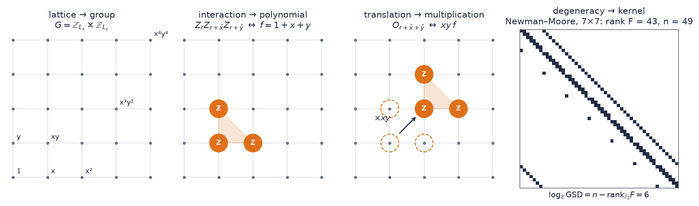
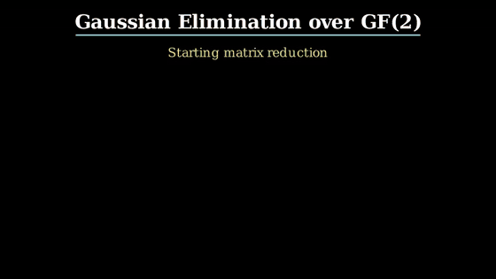
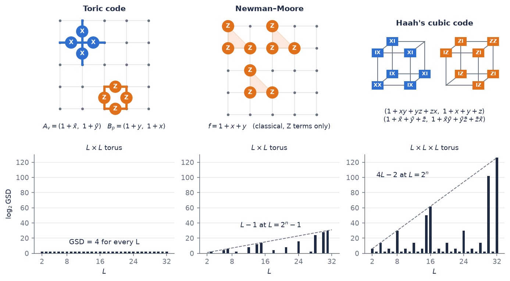
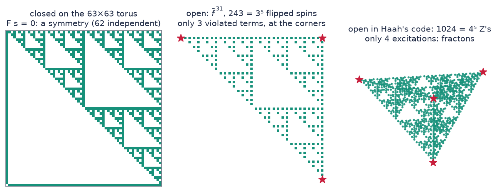
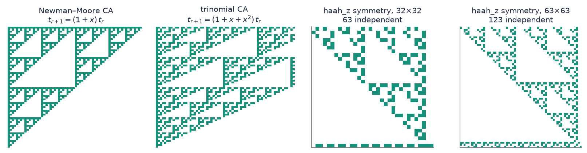
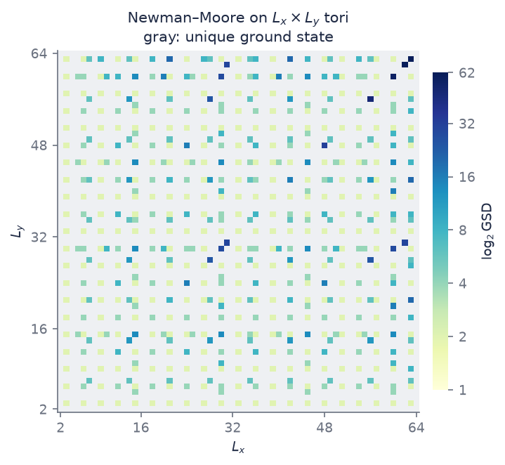

# Ground-state degeneracy in translation-invariant stabilizer models

**Lucas G. O. Corbanez, Paula F. Bienzobaz** — Universidade Estadual de Londrina (UEL)
Poster at the *XXX Semana da Física: Forças Fundamentais*, UEL, Londrina – PR, Brazil.

> Counting the ground states of a stabilizer model is linear algebra in a group ring [1]:
>
> $$\mathrm{GSD} = 2^{\,n-\mathrm{rank}_{\mathbb{F}_2}F}$$

The ground-state degeneracy of translation-invariant stabilizer Hamiltonians can be studied through an
algebraic representation of lattice interactions. Following the group-ring framework developed for
quantum codes, we encode periodic lattices as finite abelian groups and local Pauli interactions as
polynomial stencils over $\mathbb{F}_2$. Translations then become multiplication in the group algebra, and
the degeneracy problem reduces to the kernel of a finite-dimensional linear map over $\mathbb{F}_2$. This
repository implements that approach, applies it to the toric code, the Newman–Moore model and Haah's
cubic code, and uses exact finite-field calculations and pictures of the resulting patterns to relate
algebraic constraints, ground-state degeneracy and fractal subsystem symmetries.

It is written to be read: this page tells the whole story, and five notebooks work through it.

---

## Contents

1. [From the lattice to the group ring](#1-from-the-lattice-to-the-group-ring)
2. [Same algebra, three answers](#2-same-algebra-three-answers)
3. [Fractal subsystem symmetries](#3-fractal-subsystem-symmetries)
4. [UV/IR mixing](#4-uvir-mixing)
5. [Letting the algebra do the work](#5-letting-the-algebra-do-the-work)
6. [A closed form for the `haah_z` stencil](#6-a-closed-form-for-the-haah_z-stencil)
7. [Pitfalls](#7-pitfalls)
8. [Using the code](#8-using-the-code)
9. [Learning path](#9-learning-path)
10. [Beyond the exactly solvable point, and further reading](#10-beyond-the-exactly-solvable-point-and-further-reading)

---

## 1. From the lattice to the group ring



| lattice | algebra |
|---|---|
| periodic $L_x\times L_y$ lattice | the group $G=\mathbb{Z}_{L_x}\times\mathbb{Z}_{L_y}$ |
| a bit on every site | an element of $R=\mathbb{F}_2[G]=\mathbb{F}_2[x,y]/(x^{L_x}-1,\ y^{L_y}-1)$ |
| the site $(i,j)$ | the monomial $x^iy^j$ |
| a local interaction (which sites it touches) | a polynomial **stencil**, e.g. $f=1+x+y$ |
| translation by $(i,j)$ | multiplication by $x^iy^j$ |
| the interaction stamped on every site | multiplication by $f$: a (block-)circulant matrix |
| the degeneracy | a kernel, i.e. the rank of that matrix |

**Paulis to polynomials.** A Pauli term is recorded by *which* qubits it touches, relative to its origin.
With $q$ qubits per site, a term is a vector of polynomials: its $X$ part $(X_1,\dots,X_q)$ and its $Z$ part
$(Z_1,\dots,Z_q)$. The Newman–Moore interaction $Z_rZ_{r+\hat x}Z_{r+\hat y}$ is $f=1+x+y$; the term at
$r+\hat x+\hat y$ is $xy\,f$. Exponents can be negative ($\bar x\equiv x^{-1}$); on the torus they are read mod $L$.

**The check matrix.** $F$ has one row per term $O_r$ and one column per qubit (an $X$ block and a $Z$
block, $2n$ columns). Over $\mathbb{F}_2$, multiplying commuting Paulis is adding their rows, since $X^2=Z^2=\mathbb{1}$.

**The count.** If the terms commute and square to one, they share a ground space where every
$O_r=+1$. Each *independent* term halves the $2^n$-dimensional Hilbert space, so

$$\log_2\mathrm{GSD}=n-\mathrm{rank}_{\mathbb{F}_2}F .$$

Every relation $\prod_rO_r^{t_r}=\mathbb{1}$, a vector in the left kernel of $F$, makes one term
redundant and lowers the rank by one. Without relations the ground state would be unique on any lattice
where there are as many terms as qubits. All the degeneracy comes from relations, and the relations
come from the polynomial.

**Two kernels.** For a classical model (only $Z$ terms, one spin per site) $F$ is square and two
kernels of the same dimension appear:

* **relations** $\ker F^{\mathsf T}$: $f\cdot t=0$ in $R$;
* **symmetries** $\ker F$: spin-flip patterns $u$ that leave every term invariant, $\bar f\cdot u=0$.
  Starting from all spins up, they are also the ground states, so counting symmetries counts ground states.

The figure's $7\times7$ Newman–Moore matrix has rank 43 on $n=49$ spins: six relations, $\mathrm{GSD}=2^6$.
The arithmetic over $\mathbb{F}_2$ (elimination with XOR, kernels read off free columns) is worked by hand in
[notebook 01](notebooks/01_gf2_linear_algebra.ipynb):



---

## 2. Same algebra, three answers



The same computation (build $F$, take its rank over $\mathbb{F}_2$) gives three qualitatively
different answers. All values are exact $\mathbb{F}_2$ ranks on $L^2$ and $L^3$ tori.

**Toric code** [2] — two qubits per site (the edges), $A_v=(1+\bar x,\,1+\bar y)$ of $X$ type,
$B_p=(1+y,\,1+x)$ of $Z$ type. Relations: $\prod_vA_v=\prod_pB_p=\mathbb{1}$, one each, on every torus, so
$\mathrm{GSD}=4$ for every $L$ (and $p^2$ for $\mathbb{Z}_p$ qudits). **Topology fixes the answer.** The stencils
factor direction by direction: modding out $1+\bar x$ and $1+\bar y$ sets $x=y=1$, leaving a
one-dimensional quotient whatever $L$ is.
→ [notebook 03](notebooks/03_toric_code.ipynb), which also builds the logical operators and the 3D toric code.

**Newman–Moore** — classical, $f=1+x+y$. Non-zero only at special sizes, with $\log_2\mathrm{GSD}=L-1$ at
$L=2^n-1$ and a unique ground state at $L=2^n$.
→ [notebook 04](notebooks/04_fractal_symmetries.ipynb)

**Haah's cubic code** — two qubits per site of a cubic lattice and one cube term of each type,
$(1+xy+yz+zx,\ 1+x+y+z)$ for $X$ and $(1+\bar x+\bar y+\bar z,\ 1+\bar x\bar y+\bar y\bar z+\bar z\bar x)$ for $Z$.
$\log_2\mathrm{GSD}=4L-2$ at $L=2^n$, 2 for most odd $L$, and arithmetic in between.
→ [notebook 05](notebooks/05_haah_cubic_code.ipynb)

**The arithmetic of $L$ fixes the fractal models** [3]. The diagnostic is whether the polynomial factors
direction by direction. If it does, expect a constant GSD and string-like operators. If it mixes the
directions irreducibly ($1+x+y$), expect fractal symmetries and a degeneracy that depends on the
number theory of $L$.

---

## 3. Fractal subsystem symmetries



Everything here follows from one identity. Over $\mathbb{F}_2$, $(a+b)^2=a^2+b^2$, so

$$f^{2^n}=f\big(x^{2^n},\,y^{2^n}\big):$$

**a power of a stencil is the stencil itself, blown up by $2^n$.** Take $u=\bar f^{\,2^n-1}$.

* **Open.** Flipping the spins on $u$ violates only the terms $\bar f\cdot u=\bar f^{\,2^n}=1+\bar x^{2^n}+\bar y^{2^n}$:
  three of them, at the corners of a Sierpiński triangle of $3^n$ spins. The corners are isolated
  excitations, and no local operator can move one of them alone.
* **Closed.** On a $(2^n-1)$-torus $x^{2^n}=x$, so $\bar f^{\,2^n}=\bar f$ and $1+u$ satisfies $F(1+u)=0$:
  a symmetry. That is why Newman–Moore's degeneracy peaks at $L=2^n-1$.
* **Haah's code.** The same construction with $1+\bar x+\bar y+\bar z$ gives $4^n$ $Z$ operators on a
  Sierpiński tetrahedron and exactly **four** excitations at its corners: fractons [3, 4]. On a $2^n$-torus
  the four corners land on one cube and cancel, giving a closed operator.

Each kernel vector is a symmetry acting on a rigid, fractal subset of the lattice: a **fractal subsystem
symmetry**. There is one generator per such subset, so their number grows with $L$, while each one is
non-deformable. Where they come from: a stencil $f=y+g(x)$ is a linear cellular automaton,
$t_{r+1}=g(x)\,t_r$, and the closed orbits of that automaton on the torus are the kernel vectors.



Two numbers describe this, and they are independent:

* **how many** symmetries: $\log_2\mathrm{GSD}$, at most linear in $L$ (sub-extensive);
* **how big** one is: its box-counting dimension. For Newman–Moore it is $\log_2 3\approx1.585$. For the
  trinomial stencil $1+x+x^2+y$ terms collide and cancel, and a $2\times2$ transfer matrix gives exactly
  $\log_2(1+\sqrt5)=1.6942\ldots$, not the naive $\log_2 4=2$ ([notebook 04](notebooks/04_fractal_symmetries.ipynb), §5).

**Closed relations vs. physical operators.** A relation applied over the whole torus is literally the
identity. The physical symmetry operator (a membrane) is that pattern **truncated**: cut it, and the
violated terms sit only on the cut. Notebook 03 obtains the toric code's four logical strings this way,
and notebook 04 the trinomial's membranes.

---

## 4. UV/IR mixing

<p align="center"></p>

Newman–Moore on every $L_x\times L_y$ torus with sides 2–64. Gray: a unique ground state. The
$63\times63$ torus has $2^{62}$ ground states and the $64\times64$ torus has one. A microscopic detail (is
$L+1$ a power of two? what divides $L$?) controls an infrared observable, which no coarse-grained field
theory can reproduce. For the toric code the same plot is a flat 4.

---

## 5. Letting the algebra do the work

Brute force builds an $N\times N$ matrix and eliminates in $O(N^3)$. The ring gives two shortcuts, both
implemented in `gsd.quotient_dim` and checked against brute force in `tests/`.

**Kernel = quotient.** Group rings of finite groups are Frobenius algebras: for any ideal $I$,
$\dim\mathrm{Ann}(I)=\dim R/I$. So for a classical stencil

$$\log_2\mathrm{GSD}=\dim_{\mathbb{F}_2}\ker(f\cdot)=\dim_{\mathbb{F}_2}R/(f),$$

and for a stabilizer model with one $X$ species $\sigma_X=(f_1,\dots,f_q)$,
$\mathrm{rank}\,F_X=N-\dim R/(f_1,\dots,f_q)$ (likewise for $Z$).

**Eliminate a variable.** If a generator is linear in a variable, $y+g(x)$, then modulo it $y=g(x)$:

$$R/(y+g)\;\cong\;\mathbb{F}_2[x]\,/\,\big(x^{L_x}-1,\ g(x)^{L_y}-1\big).$$

$\mathbb{F}_2[x]$ is a principal ideal domain, so for the whole Newman–Moore family

$$\log_2\mathrm{GSD}=\deg\gcd\big(x^{L_x}+1,\ g(x)^{L_y}+1\big)\qquad(g=1+x\ \text{for Newman–Moore}).$$

For Haah's code, $1+x+y+z$ eliminates $z$, and an $L^3$-site problem becomes an $L^2$-site one:
$L=32$ (65 536 qubits) takes 0.04 s, and $L=128$ (4.2 million qubits) about 5 s.

---

## 6. A closed form for the `haah_z` stencil

The 2D corner stencil $f=1+x+x^2+y+xy+y^2$ (`haah_z`) is quadratic in $y$, so it cannot be eliminated
over $\mathbb{F}_2$. Over $\mathbb{F}_4=\{0,1,\omega,\omega^2\}$, $\omega^2+\omega+1=0$, it factors:

$$f=(x+\omega y+\omega^2)\,(x+\omega^2y+\omega).$$

**The fractal stencil is two straight lines over $\mathbb{F}_4$**, conjugate under Frobenius and meeting at
the singular point $(1,1)$. Write $L_x=2^am_x$, $L_y=2^bm_y$ with $m_x,m_y$ odd. Then

$$\boxed{\;\log_2\mathrm{GSD}=2\min(2^a,2^b)\,N(m_x,m_y)-[a=b],\qquad
N=\deg\gcd_{\mathbb{F}_4[y]}\big(y^{m_y}+1,\ (\omega y+\omega^2)^{m_x}+1\big).\;}$$

**Derivation in four steps.**

1. *Split the ring.* $x^{L_x}-1=(x^{m_x}-1)^{2^a}$ with $x^{m_x}-1$ squarefree, so $R$ splits into local
   factors $F[s,t]/(s^{2^a},t^{2^b})$, one per pair of roots of unity $(\zeta,\eta)$. Multiplication by $f$ is
   invertible on a factor unless $f(\zeta,\eta)=0$, so only **points of the curve $f=0$ on the torus**
   contribute.
2. *Local multiplicities.* Expanding exactly around a point,
   $f(\zeta+s,\eta+t)=f(\zeta,\eta)+(1+\eta)s+(1+\zeta)t+(s^2+st+t^2)$. A smooth point contributes
   $\min(2^a,2^b)$ (a Weierstrass change of variables). The only singular point is $(1,1)$, where
   $f=s^2+st+t^2$, and it contributes $2\min(2^a,2^b)-[a=b]$.
3. *Count the points.* The two lines meet only at $(1,1)$ and Frobenius swaps them, so the number of
   points is $P=2N-1$, with $N=\#\{\eta\in\mu_{m_y}:\omega\eta+\omega^2\in\mu_{m_x}\}$, which is the gcd
   degree above.
4. *Add up.* $(P-1)\min+2\min-[a=b]=2\min\cdot N-[a=b]$.

**Consequences.** The dependence on $L$ splits completely: the 2-part enters through $\min(2^a,2^b)$ and
$[a=b]$, the odd part through $N$. $N\ge1$ always, so the ground state is never unique, and
$\log_2\mathrm{GSD}\le2\min(L_x,L_y)$: sub-extensive.

| regime | $\log_2\mathrm{GSD}$ |
|---|---|
| generic ($N=1$) | $2\min(2^a,2^b)-[a=b]$ |
| $L_x,L_y$ both odd, generic | $1$ |
| $L_x=L_y=2^k$ | $2L-1$ |
| $L_x=L_y=2^a(2^k-1)$, $k$ even (the maximal family) | $2^a(2^{k+1}-4)-1$ |
| $L_x=L_y=2^a(2^k-1)$, $k$ odd | $2^{a+1}-1$ |

For example $N_c(15,15)=27$, $N_c(63,63)=123$, $N_c(256,256)=511$, but $N_c(256,255)=2$.

**When is $N>1$?** $N=1$ (only the singular point lies on the torus) is generic. If
$\mathrm{lcm}(\mathrm{ord}_{m_x}2,\ \mathrm{ord}_{m_y}2)$ is odd, then $\mathbb{F}_4\not\subset\mathbb{F}_{2^d}$ and $N=1$. If
$3\mid\gcd(m_x,m_y)$, then $(\omega,\omega^2)$ is on the curve and $N\ge2$. Neither condition is necessary:
for $m$ coprime to 3, the first sizes with $N(m,m)>1$ are $m=85$ and $91$. By Weil's bound, $N$ is
$m_xm_y/2^{\mathrm{ord}}+O(\sqrt{2^{\mathrm{ord}}})$, which is why the data look erratic.

The formula is in `gsd.closed_form.haah_z` and agrees with brute force on every torus with
$2\le L_x,L_y\le20$ (`tests/`) and $\le24$ (notebook 04). The *method* (find the points of $f=0$ on the
torus, then attach local multiplicities) works for any single-species stencil.

---

## 7. Pitfalls

* **The terms must commute.** Rank–nullity describes the ground space only for commuting terms.
  `Model.commutes` checks the symplectic condition $F_XF_Z^{\mathsf T}-F_ZF_X^{\mathsf T}=0$; for $\mathbb{Z}_p$ qudits
  that is what forces the orientation signs in the toric code.
* **"GSD $=2^{\#\text{relations}}$" only holds when there are as many terms as qubits.** In general
  $\log_2\mathrm{GSD}=(n-m)+\dim\ker F^{\mathsf T}$ for $n$ qubits and $m$ terms. The 2D toric code and classical
  stencils have $n=m$. The 3D toric code ($n=3N$, $m=4N$) has a size-dependent number of relations
  but $\log_2\mathrm{GSD}=3$.
* **Never stack $X$ and $Z$ supports into one binary matrix.** A support vector records *which* qubit,
  not *which* Pauli, and stacking lets an $X$ cancel a $Z$. Keep the symplectic $[X\,|\,Z]$ blocks.
* **A closed relation is the identity, not a symmetry.** The physical operator is the truncated pattern.
* **Do not count kernels of translations.** Translations are unitary, so their kernels are trivial. The
  kernel that counts is that of the constraint. Fourier-transforming the translations instead turns
  the $N$ constraints into a momentum-dependent matrix, and over $\mathbb{F}_2$ that transform is exactly the
  ring splitting of §6.
* **The prime matters.** The six-neighbour stencil factors into three line factors over $\mathbb{F}_2$
  ($\log_2\mathrm{GSD}=L_x+L_y+\gcd(L_x,L_y)-2$) but not over $\mathbb{F}_3$, where its degeneracy becomes
  sparse and number-theoretic ([notebook 02](notebooks/02_stencils_and_group_rings.ipynb)).

---

## 8. Using the code

```bash
python -m venv venv && source venv/bin/activate
pip install -r requirements.txt
python -m pytest -q                 # every number on this page, checked
python scripts/make_figures.py      # regenerate figures/
```

```python
import gsd

gsd.HAAH_CUBIC.log_gsd(32)                       # 126 = 4L - 2
gsd.TORIC_CODE.log_gsd((5, 7), p=3)              # 2: GSD = 3^2
gsd.NEWMAN_MOORE.log_gsd(63), gsd.NEWMAN_MOORE.log_gsd(64)   # 62, 0

nm = gsd.classical("mine", "1 + x + x^2 + y")    # any stencil is a model
nm.log_gsd((15, 3)), nm.symmetries(16).shape     # 5, (16, 256)

gsd.Poly("1 + x + y").pow(8)                     # 1 + x^8 + y^8   (Frobenius)
```

```
gsd/                the package (numpy only)
  ring.py           Poly (stencils), group-ring products, mult_matrix, quotient_dim
  linalg.py         rank / rref / nullspace over GF(p), bit-packed for p = 2
  models.py         Model (check matrix, commutation, log_gsd, symmetries, relations);
                    TORIC_CODE, NEWMAN_MOORE, HAAH_CUBIC and the classical STENCILS
  closed_form.py    Newman–Moore-family gcd and the haah_z F_4 formula
  fractals.py       cellular automata, Frobenius power patterns, truncation
notebooks/          the learning path (below)
scripts/
  sweep.py          log GSD over a range of tori -> CSV
  kernel_basis.py   one PNG per independent symmetry
  make_figures.py   every figure on this page
  animate_rref.py   manim animation of RREF and kernel extraction
tests/              pytest suite: brute force vs algebra vs closed forms, poster numbers
figures/            images used here
```

```bash
python scripts/sweep.py haah_cubic --L 2-32
python scripts/sweep.py newman_moore --lx 2-64 --ly 2-64
python scripts/sweep.py haah_z --L 2-1024 --method closed
python scripts/kernel_basis.py 32 --model trinomial
OP=newman_moore LX=3 LY=3 manim -ql scripts/animate_rref.py OperatorKernel
```

Conventions: array axis $k$ is variable $k$ (`a[i, j]` is the coefficient of $x^iy^j$); plots put $x$ to
the right and $y$ up; `log_gsd` returns $\log_p\mathrm{GSD}$.

---

## 9. Learning path

| notebook | what it teaches |
|---|---|
| [01 · GF(2) linear algebra](notebooks/01_gf2_linear_algebra.ipynb) | RREF and kernels by hand; why there are no minus signs; all sixteen $2\times2$ matrices; GF(p) |
| [02 · Stencils and group rings](notebooks/02_stencils_and_group_rings.ipynb) | rolling = multiplication; a delta gives one column; validation; the six-neighbour stencil over $\mathbb{F}_2$ and $\mathbb{F}_3$; kernel = quotient; eliminating a variable |
| [03 · Toric code](notebooks/03_toric_code.ipynb) | two qubit species; commutation; GSD $=4$ on every torus and $p^2$ for qudits; logical operators from truncated relations; the 3D toric code |
| [04 · Fractal symmetries](notebooks/04_fractal_symmetries.ipynb) | Newman–Moore, trinomial, `haah_z`; UV/IR mixing; closed forms; cellular automata; Frobenius; exact fractal dimension; membranes; restricted mobility |
| [05 · Haah's cubic code](notebooks/05_haah_cubic_code.ipynb) | 3D, two qubits per site; brute force vs. elimination; $4L-2$; fractal operators and fractons |

---

## 10. Beyond the exactly solvable point, and further reading

**Only commuting models.** The method needs commuting terms. For non-commuting Hamiltonians there is no
check matrix to take a kernel of, and degeneracy has to come from other tools (representation theory,
TQFT data, tensor networks, numerics).

**But it describes a phase, not a point.** Under weak local perturbations that keep the gap open, the
degeneracy of a commuting-projector model survives up to exponentially small splitting (Bravyi,
Hastings, Michalakis, arXiv:1001.0344; quasi-adiabatic continuation, Hastings & Wen 2005; for
frustration-free models, Michalakis & Zwolak 2013). Stabilizer codes are fixed points representing whole
phases (De Roeck *et al.*, arXiv:2411.02384), and interpolating between solvable points locates
transitions (Trebst *et al.*, arXiv:cond-mat/0609048). Fracton models are more delicate: their degeneracy
is sub-extensive and sensitive to the arithmetic of $L$.

**Further reading.**
J. Haah, arXiv:1101.1962 (cubic code; origin of the polynomial method) and arXiv:1204.1063 (Pauli
Hamiltonians as maps between free modules) ·
Devakul, Williamson, You, arXiv:1805.04097 (fractal symmetric phases) ·
Williamson & Devakul, *Quantum* 3, 142 (2019) (subsystem symmetries and cellular automata) ·
D. J. Williamson, arXiv:1603.05182 (ungauging the cubic code) ·
Vijay, Haah, Fu, arXiv:1603.04442 (fracton order and gauging duality) ·
Kubica & Yoshida, arXiv:1805.01836 (ungauging quantum codes) ·
Pretko, Chen, You, arXiv:2001.01722 (fracton review).

### References

1. J. Haah, *Algebraic methods for quantum codes on lattices*, Revista Colombiana de Matemáticas **50**,
   299 (2017), arXiv:1607.01387.
2. A. Y. Kitaev, *Fault-tolerant quantum computation by anyons*, Annals of Physics **303**, 2 (2003),
   arXiv:quant-ph/9707021.
3. H. Casasola, G. Delfino, Y. You, P. F. Bienzobaz, P. R. S. Gomes, *Fractal subsystem symmetries,
   anomalies, boundaries, and effective field theory*, Phys. Rev. B **110**, 195105 (2024),
   arXiv:2406.19275.
4. C. Chamon, *Quantum glassiness*, Phys. Rev. Lett. **94**, 040402 (2005), arXiv:cond-mat/0404182.

### Acknowledgments

CAPES for financial support, and the Programa de Pós-Graduação em Física da UEL.
Contact: lucas.gomes.oliveira@uel.br
